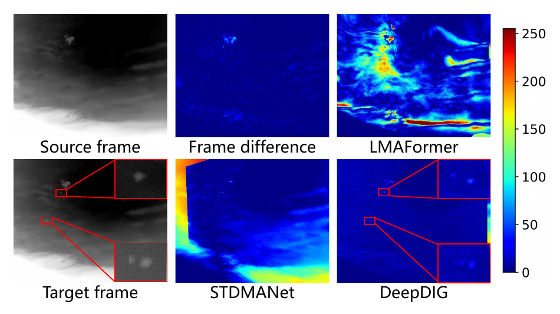
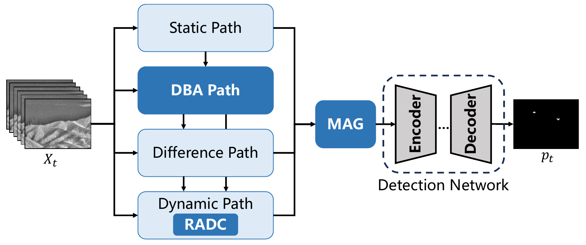
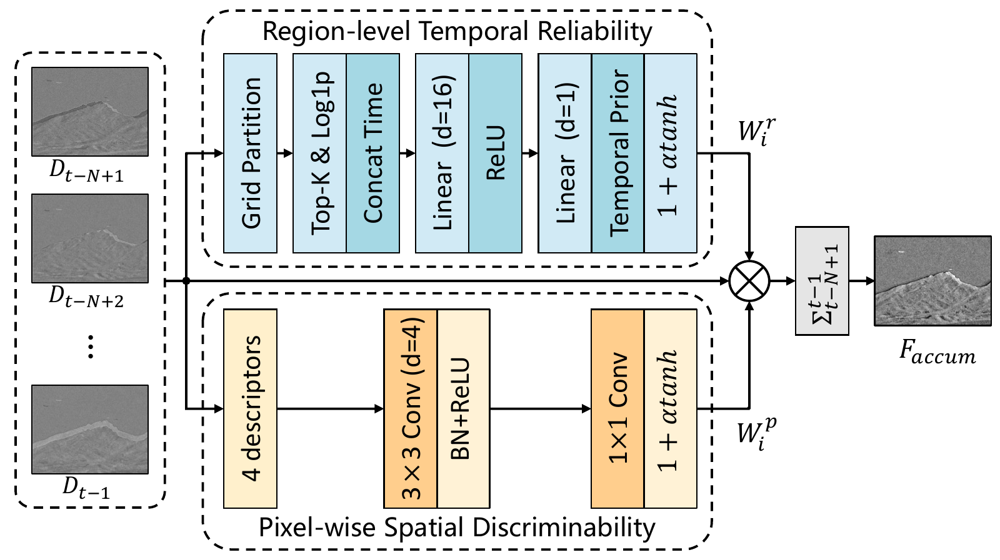
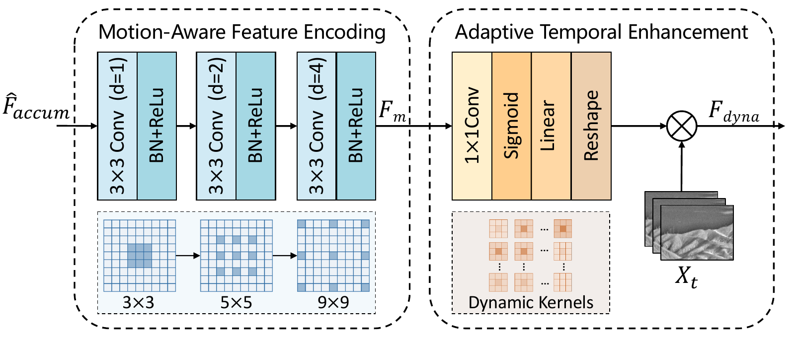
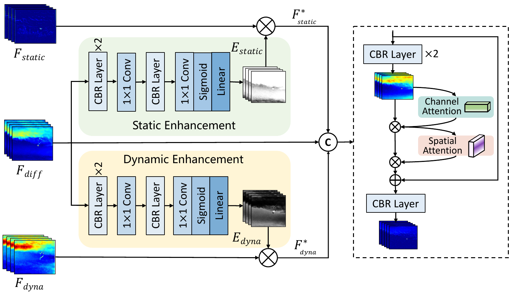
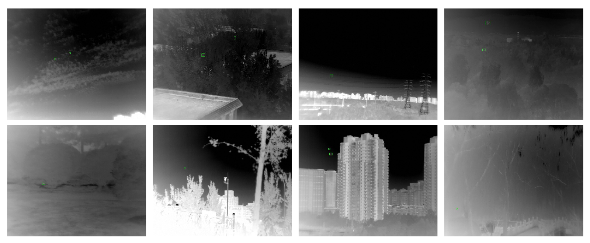
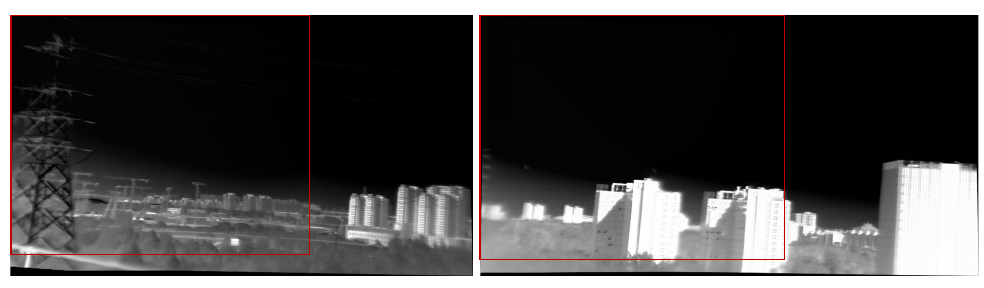
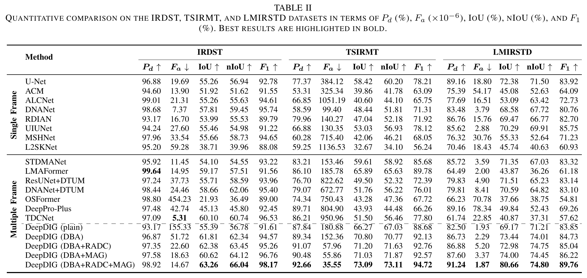
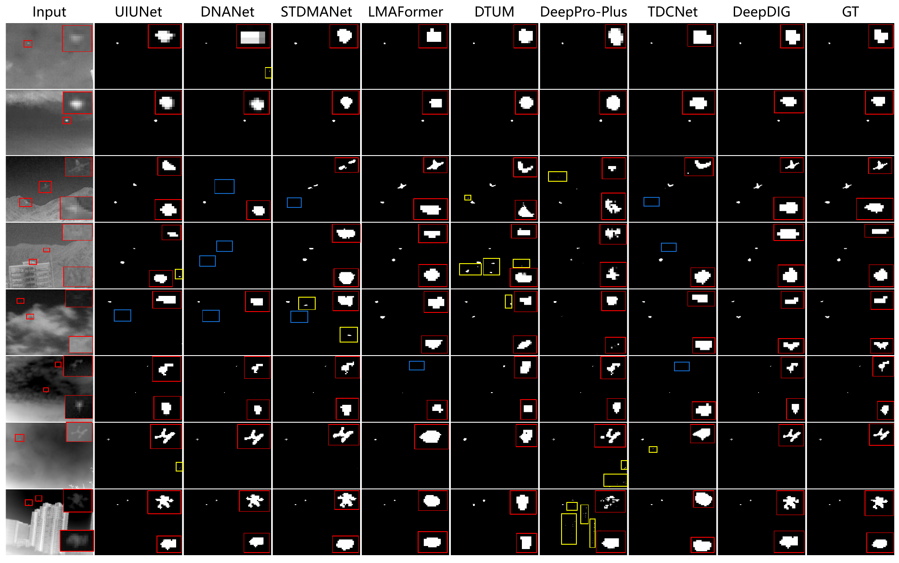

<h1 align="center">DeepDIG: Deep Background Alignment Helps See Infrared Small Target Better</h1>

DeepDIG detects infrared small targets in moving-camera video through background alignment and spatiotemporal modeling.

This repository provides the **DBA + RADC + MAG** model, evaluation code and pretrained checkpoints. Figures and results below are from the paper; please refer to it for method details.

## Method

<p align="center">
  
  
</p>

<p align="center">
  <strong>Figure 1.</strong> Frame differences and feature responses under background motion.<br>
  <strong>Figure 2.</strong> DeepDIG aligns historical frames and combines static, difference and dynamic features for detection.
</p>

### Deep Background Alignment (DBA)

DBA reuses static-encoder features to construct deep descriptors for cross-frame background alignment.

### Reliability-Aware Dynamic Convolution (RADC)

RADC combines **Reliability-Aware Temporal Aggregation (RATA)** and **Content-Adaptive Dynamic Convolution (CADC)** to refine temporal features using reliable motion cues.

<p align="center">
  
  
</p>

<p align="center">
  <strong>Figure 3.</strong> RATA weights temporal differences using regional reliability and pixel-wise discriminability.<br>
  <strong>Figure 4.</strong> CADC generates spatially adaptive dynamic kernels from accumulated motion cues.
</p>

### Motion-guided Adaptive Gating (MAG)

<p align="center">
  
</p>

<p align="center"><strong>Figure 5.</strong> MAG uses inter-frame differences to guide adaptive fusion of spatial and temporal features.</p>

## LMIRSTD Dataset

The **Large-motion Multi-frame IRST Detection (LMIRSTD)** dataset contains **60 infrared sequences** (**45 training / 15 test**), with 200 frames per sequence at **640×512** resolution (width×height), totaling **12,000 frames**.

LMIRSTD features pronounced background motion and dim targets, with mean SCR **2.25**. Small, medium and large targets account for **32.0%, 50.6% and 17.4%**, respectively.

<p align="center">
  
</p>

<p align="center"><strong>Figure 6.</strong> Representative LMIRSTD backgrounds, with true targets marked by green boxes.</p>

<p align="center">
  
</p>

<p align="center"><strong>Figure 7.</strong> Panoramas stitched from 50 consecutive LMIRSTD frames; red boxes mark individual 640×512 frames.</p>

**Table I** compares multi-frame IRST detection datasets.

| Dataset | Mean SCR | Motion Mag. |
|---|---:|---:|
| IRDST | 6.70 | 40.17 pixels |
| TSIRMT | 3.04 | 17.69 pixels |
| LMIRSTD | 2.25 | 60.44 pixels |

- **Mean SCR**: mean signal-to-clutter ratio, indicating target contrast relative to background clutter; lower values indicate less salient targets.
- **Motion Mag.**: mean pixel displacement of the background between the two frames exhibiting the largest inter-frame motion within each temporal window.

Download LMIRSTD from the [dataset folder](https://drive.google.com/drive/folders/1dp31_tDtGXmNUhTHD_0GqEGBLAVNUYb0).

## Paper Results

### Quantitative comparison

<p align="center">
  
</p>

<p align="center"><strong>Table II.</strong> Quantitative comparison on IRDST, TSIRMT and LMIRSTD; Fa is in units of 10<sup>−6</sup>, and all other metrics are percentages.</p>

### Qualitative comparison

<p align="center">
  
</p>

<p align="center"><strong>Figure 8.</strong> Qualitative comparison: red, blue and yellow boxes mark correct detections, missed targets and false alarms, respectively.</p>

### Efficiency

Table III reports full-pipeline efficiency, including background alignment and inference, at **256×256** resolution on an **NVIDIA RTX 4090D**.

| Method | FPS ↑ | Parameters | GFLOPs |
|---|---:|---:|---:|
| STDMANet | 4.37 | 11.88M | 62.98 |
| LMAFormer | 0.65 | 407.67M | 615.96 |
| TDCNet | 2.90 | 40.46M | 3822.91 |
| DeepDIG | 9.15 | 15.21M | 33.14 |

## Installation and checkpoints

Download the three complete DeepDIG checkpoints from the [Google Drive weights folder](https://drive.google.com/drive/folders/1duJ4M6fwDdcLkgSOd1911EqphCNk4BV1):

| Dataset | Filename |
|---|---|
| IRDST | `DeepDIG_IRDST.pth` |
| TSIRMT | `DeepDIG_TSIRMT.pth` |
| LMIRSTD | `DeepDIG_LMIRSTD.pth` |

Place them in the ignored `weights/` directory and pass the actual path through `--ckpt`. A complete checkpoint contains the descriptor branch, so no additional first-stage XFeat checkpoint or GIM/SIFT dependency is needed. The checkpoint loader accepts a pure state dictionary or a checkpoint containing `state_dict`, removes an optional `module.` prefix, automatically maps published checkpoint keys to the RADC module names, and loads **strictly**. Explicitly labelled pipeline checkpoints must be `full`. Use the full configuration with 20 frames and 3×3 dynamic kernels. Checkpoints must match the published network structure.

Reference validation environment: Linux, Python 3.10, PyTorch 2.6.0+cu126. Runtime versions in `requirements.txt` match the validation environment. Install the appropriate PyTorch build first:

```bash
conda create -n deepdig python=3.10
conda activate deepdig
pip install torch==2.6.0 --index-url https://download.pytorch.org/whl/cu126
pip install -r requirements.txt
```

For CPU, use `pip install torch==2.6.0 --index-url https://download.pytorch.org/whl/cpu` instead. Optional `--profile` requires `thop`, which is not needed for inference or evaluation.

## Test

From the repository root, with IRDST in `dataset/IRDST/` and its checkpoint in `weights/`, run:

```bash
python test_deepdig.py --dataset IRDST --root ./dataset \
  --ckpt ./weights/DeepDIG_IRDST.pth --in_channels 20 --test_batch_size 2 \
  --output_dir ./results/IRDST
```

This evaluates the full test split and saves `results.json` and `results.txt` to `results/IRDST/`; for another dataset, change the dataset name, checkpoint and output directory while keeping 20 frames and batch size 2.
