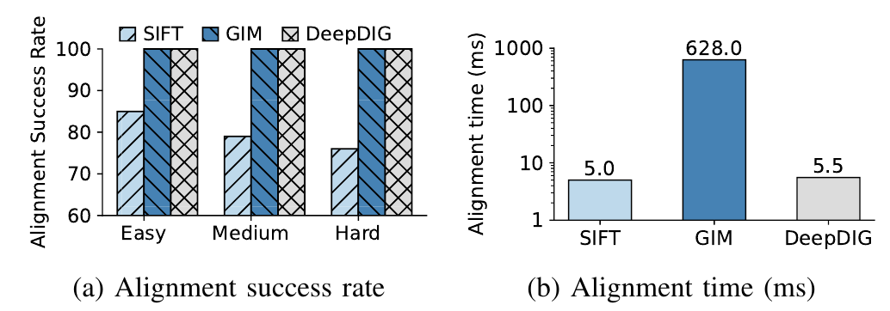
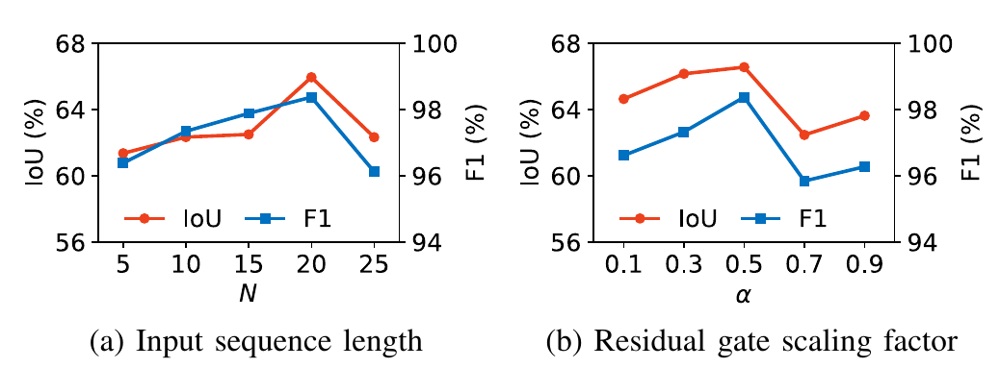
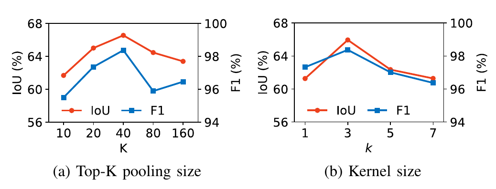
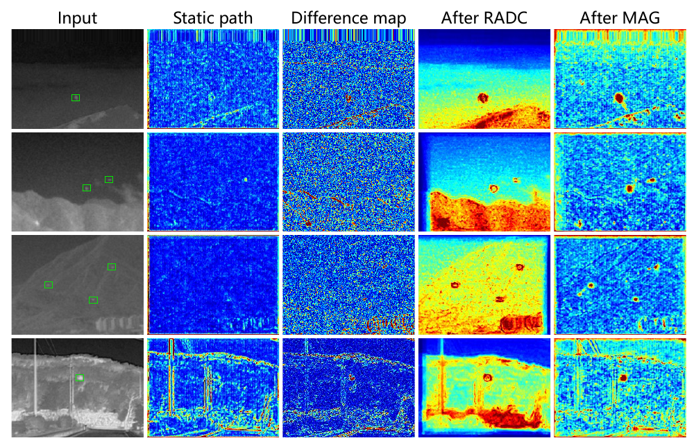
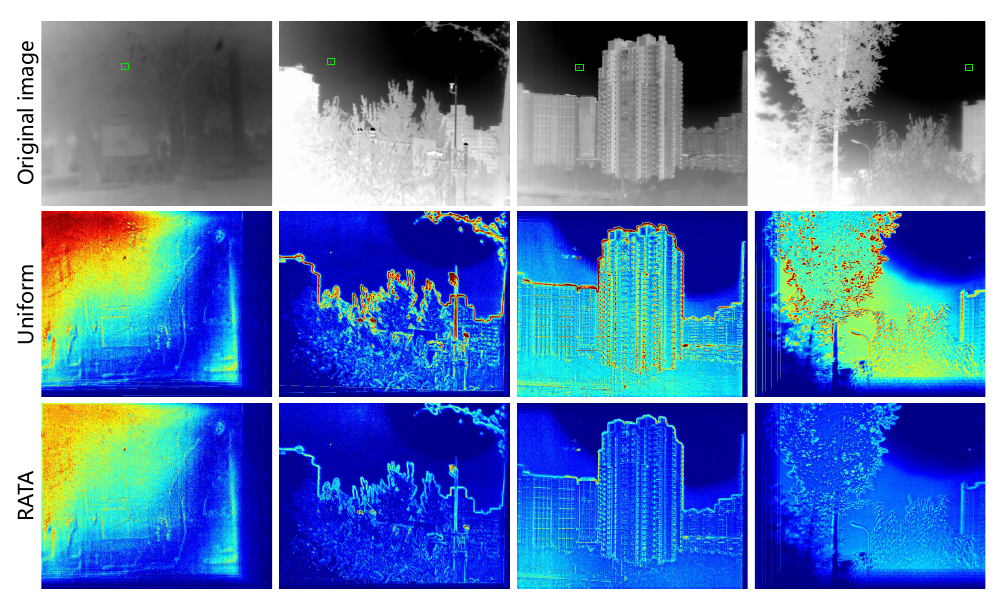

<h1 align="center">DeepDIG: Deep Background Alignment Helps See Infrared Small Target Better</h1>

DeepDIG detects infrared small targets in moving-camera video through background alignment and spatiotemporal modeling.

This repository provides the **DBA + RADC + MAG** model, evaluation code and pretrained checkpoints. Figures and results below are from the paper; please refer to it for method details.

<p align="center">
  
</p>

## Method

<p align="center">
  
</p>

DeepDIG aligns historical frames to the current frame and combines static, difference and dynamic features for target detection.

### Deep Background Alignment (DBA)

DBA reuses static-encoder features to construct deep descriptors for cross-frame background alignment.

### Reliability-Aware Dynamic Convolution (RADC)

RADC combines **Reliability-Aware Temporal Aggregation (RATA)** and **Content-Adaptive Dynamic Convolution (CADC)** to refine temporal features using reliable motion cues.

<table align="center">
  <tr><th>RATA (Figure 3)</th><th>CADC (Figure 4)</th></tr>
  <tr>
    <td></td>
    <td></td>
  </tr>
</table>

### Motion-guided Adaptive Gating (MAG)

MAG uses inter-frame differences to guide adaptive fusion of spatial and temporal features.

<p align="center">
  
</p>

### Source map

| Component | Source |
|---|---|
| Complete model | [deep_dig.py](model/deep_dig.py) |
| Static path and descriptor head | [static_path.py](model/static_path.py), [UNet_CBAM.py](model/UNet_CBAM.py) |
| DBA and frame alignment | [DBA_module.py](model/DBA_module.py), [frame_cache.py](model/frame_cache.py) |
| Difference path | [difference_path.py](model/difference_path.py) |
| RADC (RATA and CADC) | [RADC_module.py](model/RADC_module.py) |
| Dynamic feature encoder | [dynamic_path.py](model/dynamic_path.py) |
| MAG | [MAG_module.py](model/MAG_module.py) |
| Detection head | [detection_network.py](model/detection_network.py) |

## LMIRSTD Dataset

The **Large-motion Multi-frame IRST Detection (LMIRSTD)** dataset contains **60 infrared sequences** (**45 training / 15 test**), with 200 frames per sequence at **640×512** resolution (width×height), totaling **12,000 frames**.

LMIRSTD features pronounced background motion and dim targets, with mean SCR **2.25**. Small, medium and large targets account for **32.0%, 50.6% and 17.4%**, respectively.

<p align="center">
  
</p>

<p align="center">
  
</p>

Panoramas use **50 consecutive frames**; red boxes mark individual 640×512 frames.

Table I reports normalized inter-frame background displacement (NIBD): mean displacement of a 20×20 grid under the estimated background similarity transform, as a percentage of the image diagonal. P50/P95 are the median/95th percentile over accepted adjacent-frame pairs; screening coverage is the fraction passing geometric checks.

| Dataset | Mean SCR | Background motion | NIBD P50 (% diagonal/frame) | NIBD P95 (% diagonal/frame) | Screening coverage (%) |
|---|---:|---|---:|---:|---:|
| IRDST | 6.70 | Large | 0.144 | 3.713 | 71.65 |
| TSIRMT | 3.04 | Mild | 0.460 | 0.918 | 99.50 |
| LMIRSTD | 2.25 | Large | 0.329 | 1.020 | 96.71 |

Download LMIRSTD from the [dataset folder](https://drive.google.com/drive/folders/1dp31_tDtGXmNUhTHD_0GqEGBLAVNUYb0).

## Paper Results

### Quantitative comparison

Table II compares methods on IRDST, TSIRMT and LMIRSTD. **Fa is in units of $10^{-6}$; all other metrics are percentages.**

<p align="center">
  
</p>

### Qualitative comparison

<p align="center">
  
</p>

Red, blue and yellow boxes mark correct detections, missed targets and false alarms, respectively.

### Efficiency

Table III reports full-pipeline efficiency, including background alignment and inference, at **256×256** resolution on an **NVIDIA RTX 4090D**.

| Method | FPS ↑ | Parameters | GFLOPs |
|---|---:|---:|---:|
| STDMANet | 4.37 | **11.88M** | 62.98 |
| LMAFormer | 0.65 | 407.67M | 615.96 |
| TDCNet | 2.90 | 40.46M | 3822.91 |
| DeepDIG | **9.15** | 15.21M | **33.14** |

### Background alignment

Figure 9 reports **100% alignment success** for DeepDIG under the three tested synthetic homography levels on LMIRSTD and **5.54 ms per image pair**.

<p align="center">
  
</p>

Table IV compares alignment methods on **IRDST**, with RADC and MAG retained:

| Method | Pd ↑ | Fa ↓ | IoU ↑ | nIoU ↑ | F1 ↑ |
|---|---:|---:|---:|---:|---:|
| DeepDIG (SIFT + RADC + MAG) | 96.88 | 73.58 | 54.22 | 62.35 | 95.64 |
| DeepDIG (GIM + RADC + MAG) | 98.80 | **12.55** | 61.40 | 63.82 | **98.27** |
| DeepDIG (DBA + RADC + MAG) | **98.92** | 14.67 | **63.26** | **66.04** | 98.17 |

### Sensitivity and feature analysis

The IRDST sensitivity experiments select **N=20**, **α=0.5**, **K=40** and a **3×3** kernel among the tested settings.

<p align="center">
  
  
</p>

Figures 12–13 show intermediate features and compare uniform accumulation with RATA. Green boxes mark true targets.

<p align="center">
  
  
</p>

## Installation and checkpoints

Download the three complete DeepDIG checkpoints from the [Google Drive weights folder](https://drive.google.com/drive/folders/1duJ4M6fwDdcLkgSOd1911EqphCNk4BV1):

| Dataset | Filename |
|---|---|
| IRDST | `DeepDIG_IRDST.pth` |
| TSIRMT | `DeepDIG_TSIRMT.pth` |
| LMIRSTD | `DeepDIG_LMIRSTD.pth` |

Place them in the ignored `weights/` directory and pass the actual path through `--ckpt`. A complete checkpoint contains the descriptor branch, so no additional first-stage XFeat checkpoint or GIM/SIFT dependency is needed. The checkpoint loader accepts a pure state dictionary or a checkpoint containing `state_dict`, removes an optional `module.` prefix, automatically maps published checkpoint keys to the RADC module names, and loads **strictly**. Explicitly labelled pipeline checkpoints must be `full`. Use the full configuration with 20 frames and 3×3 dynamic kernels. Checkpoints must match the published network structure.

Reference validation environment: Linux, Python 3.10, PyTorch 2.6.0+cu126. Runtime versions in `requirements.txt` match the validation environment. Install the appropriate PyTorch build first:

```bash
conda create -n deepdig python=3.10
conda activate deepdig
pip install torch==2.6.0 --index-url https://download.pytorch.org/whl/cu126
pip install -r requirements.txt
```

For CPU, use `pip install torch==2.6.0 --index-url https://download.pytorch.org/whl/cpu` instead. Optional `--profile` requires `thop`, which is not needed for inference or evaluation.
